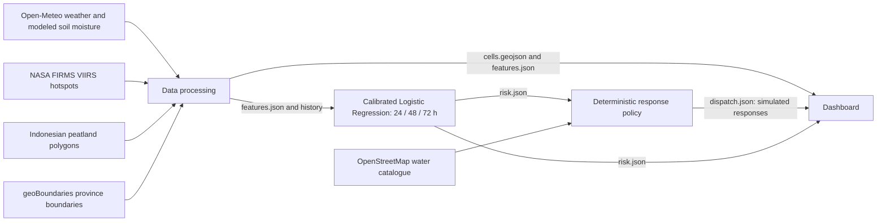

# Peatland Fire Alert System

**Kodang Koding Kiding · IBM Z Datathon 2026**

An early-warning prototype that estimates surface-hotspot risk in Indonesian
peatland grid cells over **24, 48, and 72 hours**, then turns those estimates into
simulated, audience-specific responses. It combines weather, modeled soil
moisture, satellite fire detections, and peatland maps in a shared dashboard.

The current regional scope is **40 cells across five Indonesian Kalimantan
provinces**, eight per province. The selected prediction models are **three
calibrated scikit-learn Logistic Regression classifiers**, one per horizon.
The system supports a dated historical replay and an automatic live pipeline.
All notifications and dispatches are simulated.

## Problem and intended impact

Peat fires can smolder beneath the surface before visible signs appear. Thermal
satellite detections do not directly observe that underground activity. This
project uses environmental conditions and recent hotspot activity to estimate
future surface-hotspot occurrence and help people prioritize inspections,
patrols, and preventive work.

The dashboard serves fire crews (Manggala Agni), community fire volunteers
(MPA), regional disaster agencies (BPBD), peatland restoration teams (the `brgm`
audience key), and leadership. Each audience receives relevant information in
Indonesian and English. Predictions support human review; operational warning
reliability has not been established.

## Architecture



The automatic service runs ingestion → inference → simulated responses →
cross-file validation. It publishes all four dashboard feeds together only
after every stage succeeds. The browser checks for new generations every minute;
the service refreshes at startup and each UTC clock hour. **Refresh live data**
requests the same complete pipeline immediately. Training is separate.

## Quick start

Run commands from the repository root. Use **Python 3.12**, Git, and Git LFS.
Bash and Make are used by the convenience commands; Python entry points also
work directly on Windows. Docker is optional. Node.js is needed only for the
JavaScript checks, with no frontend package installation or build step.

```bash
git clone https://github.com/ProProcer/peatland-alert-system.git
cd peatland-alert-system
git lfs install --local
git lfs pull
python3.12 -m venv .venv
source .venv/bin/activate
python -m pip install -r e_platform/requirements-live.txt
make validate
```

The live requirements include ingestion, modeling, and shared validation tools.
They constrain scikit-learn to **1.6.1**, matching the saved artifacts, and
pandas to version 2. Do not upgrade the artifact environment without validating
compatibility or retraining.

On Windows PowerShell, replace environment creation/activation with:

```powershell
py -3.12 -m venv .venv
.\.venv\Scripts\Activate.ps1
python -m pip install -r e_platform/requirements-live.txt
python -m contracts.validate
```

Git LFS supplies historical Parquet, raw FIRMS exports, OSM inputs, and large
cached source files. A small LFS pointer is not the dataset; retrieve the actual
objects before using historical or live workflows.

### View the historical dashboard

```bash
python -m d_frontend.serve_demo
```

Open **http://127.0.0.1:8001**. This serves the 40-cell historical bundle at
`2026-10-16T00:00:00Z`. Missing predictions or responses are shown as unavailable.
The server can display the geometry and measurements without model inference.

To generate matching regional predictions and simulated responses for this
dashboard, run these commands before starting it, or reload after they finish:

```bash
python -m b_model.predict --config-name replay_regional paths.output=data/demo/role_a_real/regional_40/risk.json
python -m c_agent.agent --data-dir data/demo/role_a_real/regional_40 --output data/demo/role_a_real/regional_40/dispatch.json --water-sources data/demo/role_a_real/water_sources.geojson
python -m contracts.validate --data-dir data/demo/role_a_real/regional_40
```

These commands add model/response outputs to that demo bundle; they do not
retrain models or modify its source features/history. The normal B-only replay
command, `python -m b_model.predict --config-name replay_regional`, instead
writes risk into B's evidence directory. Matching source/model paths and
fingerprints are listed in [CURRENT_HANDOFF.json](b_model/CURRENT_HANDOFF.json).

### Run the automatic live dashboard

Copy `.env.example` to `.env` if it does not exist, then set your private
`FIRMS_MAP_KEY`. The adapter also accepts the key from the process environment.
Keep `.env` private.

```bash
python -m e_platform.live_service --port 8001
```

Open **http://127.0.0.1:8001** and leave the process running. Stop another server
on that port first, or use `--port 8002`. A one-shot refresh is available with
`python -m e_platform.live_service --once` or `make live-once`.

Live data and incident state stay in ignored `data/runtime/live/`; historical
data and model artifacts are preserved. The first page waits for a complete
snapshot. A failed later refresh retains the last successful generation and
shows its age/error; live mode never substitutes historical or synthetic data.
Data older than three hours is marked stale. Inspect `/live/status` for freshness
as well as service reachability.

See [LIVE_OPERATIONS.md](e_platform/LIVE_OPERATIONS.md) for scheduling, restart
behavior, Windows logon tasks, Linux systemd, and manual refresh details.

### Validate synthetic handoffs without live services

For a small development environment:

```bash
bash scripts/setup.sh e
source .venv/bin/activate
make mock
```

This validates and replays the three-cell role fixtures into `data/demo/`,
without provider calls or model inference. Synthetic risk values are interface
fixtures, never evaluated performance. `make demo` is the legacy integration
server wrapper on port 8000; use `d_frontend.serve_demo` for the regional
dashboard or `e_platform.live_service` for automatic operation.

## Prediction model

### Selected regional models

| Property | Implementation |
| --- | --- |
| Algorithm | scikit-learn Logistic Regression, independently fitted per horizon |
| Artifact directory | `b_model/model_regional_40/` |
| Model version | `v1-regional40-20261017` |
| Horizons | 24, 48, and 72 hours |
| Input predictors | 27 canonical numeric features |
| Preprocessing | Training-fitted median imputation and standardization |
| Class imbalance | `class_weight="balanced"` |
| Regularization | `C=0.001` for 24/48 h; `C=0.1` for 72 h |
| Probability calibration | Sigmoid calibration on a separate chronological slice |
| Export | One joblib bundle per horizon, with a shared artifact manifest |
| Output | 120 risk records per complete 40-cell snapshot |

The target is at least one nominal/high-confidence FIRMS hotspot **anywhere in
the cell** during `(t, t + horizon]`. It includes continuing or recurrent fire
activity. A peat-centered cell can contain non-peat areas, so the target is not
strictly peat-only ignition or a measurement of underground fire.

The feature groups are:

| Group | Count | Examples |
| --- | ---: | --- |
| Peat | 2 | Peat fraction and area |
| Weather / modeled soil | 14 | Temperature, precipitation, wind, five soil-moisture layers, VPD |
| Derived drying signals | 7 | Trailing rainfall, days since rain, deep-soil moisture change |
| Recent fire activity | 4 | Recent/nearby hotspots, summed fire radiative power, nearest distance |

Exact fields, units, and null rules are in [CONTRACTS.md](contracts/CONTRACTS.md).
`top_factors` contains signed directional heuristics based on standardized
features and saved weights. These are not SHAP values or causal explanations.

### Model selection and evaluation

The regional comparison ran **36 fits**: three approaches × three horizons ×
four chronological periods. It compared the 27-feature Logistic Regression,
a 29-feature weighted XGBoost model, and a calibrated dryness baseline.
Mean Average Precision across the first three development periods selected
Logistic Regression for every horizon before final-period scoring. Training,
calibration, and validation are separated by gaps of at least 72 hours.

The supplied history contains 656,640 rows; 653,760 have all three targets known.
The final training period ends August 31, 2026; calibration uses September 4–18;
validation uses **September 22–October 13, 2026**, with 21,120 hourly cell rows.

| Horizon | Accuracy at 0.50 | Precision at 0.50 | Recall at 0.50 | Average Precision | Brier score |
| --- | ---: | ---: | ---: | ---: | ---: |
| 24 h | 79.1% | 84.3% | 52.9% | 0.8480 | 0.1310 |
| 48 h | 83.0% | 89.3% | 69.8% | 0.9024 | 0.1177 |
| 72 h | 86.1% | 92.9% | 76.6% | 0.9273 | 0.1026 |

These are recorded **retrospective regional results**, not synthetic metrics or
prospective guarantees. The diagnostic classification cutoff 0.50 is separate
from dashboard risk boundaries. Average Precision measures ranking, not accuracy;
lower Brier scores indicate better probability error.

For cells with no hotspot in the preceding 24 hours, recall at 0.50 is **9.4%,
30.8%, and 40.1%** for the three horizons. This weaker early-warning subgroup,
correlated forecast windows, unresolved archive/NRT source coverage, and the
lack of an independent future/geographic test limit interpretation. The model
passes its saved minimal candidate gate, which is not operational certification.

See [REGIONAL_RESULTS.md](b_model/REGIONAL_RESULTS.md),
[saved metrics](b_model/model_regional_40/metrics.json),
[quality gate](b_model/model_regional_40/quality_gate.json), and
[FINAL_HANDOFF.md](b_model/FINAL_HANDOFF.md) for evidence and limitations.

### Other model implementations

The repository retains XGBoost, histogram gradient boosting, optional IBM Snap
ML boosting, older Logistic Regression models, and a separate recency-study
candidate. The generic `b_model.train model=auto` path prefers Snap ML when
available and otherwise uses XGBoost. That training default does not identify
the selected regional inference model. Generic inference defaults to the
separate uploaded `b_model/model/` artifacts; always specify `replay_regional`
or the regional model directory for the main demo.

The tree pipeline supports two additional causal indicators, cumulative dry
days and soil-moisture momentum, for 29 predictors. Those indicators are not
used by the selected 27-feature regional classifiers. The recency candidate
has not been promoted. Snap ML acceleration and LinuxONE performance require
hardware evidence; they are not implied by optional library support.

To reproduce research, copy [backtest_regional.yaml](b_model/conf/backtest_regional.yaml)
and choose fresh run/evidence directories, then run
`python -m b_model.backtest --config <copy.yaml>`. Package to a fresh B-owned
directory with `python -m b_model.regional_handoff --config <copy.yaml> --model-dir b_model/runs/new_regional_model`.
Existing run/artifact directories are refused. Never train over published models.

## Response agent and dashboard

The current deterministic policy selects each cell's driving horizon by highest
risk level, then score, then shortest horizon. **HIGH and CRITICAL both create
simulated DISPATCH records for all five audiences**, with priority 2 and 1
respectively. LOW and MODERATE do not trigger dispatch. CRITICAL cells within
the configured distance are clustered; multi-cell incidents also receive a
leadership brief. Persistent state handles deduplication, escalation, and the
default six-hour cooldown. The default clustering/water-search radius is 15 km.

Bilingual message templates work without an LLM. Optional `--llm` rewriting
supports Gemini or Anthropic, with provider/key/model settings documented in
[Role C's guide](c_agent/README.md). Rewrites are validated against structured
facts and fall back to templates when invalid. The automatic live service
explicitly disables LLM rewriting; it needs no LLM key. No LLM predicts risk or
chooses actions, coordinates, priorities, or audiences.

Mapped water candidates come from the OSM-derived catalogue, with 21,883
candidates. Lookup uses the incident target; missing or out-of-radius sources
remain `null`. A mapped source does not establish water availability, field
access, suitability, or a travel route. Email and social-media outputs are
simulation previews; nothing is sent externally.

The browser interface provides a regional SVG map, 24/48/72-hour selectors,
cell measurements and contributing factors, risk summaries, a watchlist,
historical environmental analytics, and a simulated response workspace.
OSM basemap tiles require internet access; vector data remains usable without
tiles. Gray outside the supplied peat mask is not proof that peat is absent.

## Data sources and provenance

| Dataset / service | Use and attribution |
| --- | --- |
| [Open-Meteo Historical Forecast](https://open-meteo.com/en/docs/historical-forecast-api) and [Forecast API](https://open-meteo.com/en/docs) | Modeled weather/soil moisture; historical requests use `icon_global`, the current live request uses `dwd_icon_global`. Source metadata records the difference. See [API templates](data/raw/open-meteo_api.md). Weather attribution/license is recorded as CC BY 4.0. |
| [NASA FIRMS VIIRS](https://firms.modaps.eosdis.nasa.gov/download/) | J1/J2 archive and NRT thermal detections; [live API](https://firms.modaps.eosdis.nasa.gov/api/) needs a private MAP_KEY. Nominal/high confidence feeds the agreed labels. Satellite coverage and delays remain relevant. |
| Indonesian peat polygons, described in the playbook as [Global Forest Watch](https://www.globalforestwatch.org/) data | Bundled `data/raw/Indonesia_Peat_Lands.geojson`; exact original layer URL, survey date, and license are unverified. Preserve this provenance limitation. |
| [geoBoundaries Indonesia ADM1](https://www.geoboundaries.org/api/current/gbOpen/IDN/ADM1/) | Province filtering and map extent. Cached metadata attributes OSM/Wambacher, represented year 2017, ODbL. |
| [Geofabrik Kalimantan](https://download.geofabrik.de/asia/indonesia/kalimantan.html) / [OpenStreetMap contributors](https://www.openstreetmap.org/copyright) | OSM water-feature catalogue and map tiles. Water extract: `kalimantan-261016.osm.pbf`; OSM data is ODbL. The map displays attribution. |

All timestamps are UTC with `Z`. JSON coordinates use named `lat` and `lon`;
GeoJSON uses `[lon, lat]`. Missing measurements/unknown future labels are `null`.
Grid cells are 0.1° squares, about 11 km per side, with peat fraction at least
0.05. The current sample is spread across provinces and is not complete or
area-weighted regional coverage. No peat-depth feature is supplied.

Processing, source fingerprints, feature definitions, and reproduction details
are in [REGIONAL_HANDOFF.md](a_data/REGIONAL_HANDOFF.md). Earlier 33-cell
`data/processed/` feeds remain a separate scope. Consume matching features,
history, geometry, risk, and dispatch together; do not substitute one feed from
another scope.

## IBM LinuxONE and containers

IBM LinuxONE / s390x is the deployment target. The repository includes Docker
images, a systemd template, and portable historical-data tooling. Actual
installation, inference timing, and hardware acceleration must be supported by
evidence from the team's instance. Local timings or an x86 container build do
not establish s390x compatibility.

```bash
# Synthetic integration container, port 8000.
docker compose up --build demo

# Live pipeline and dashboard, port 8001; configure .env and retrieve LFS first.
docker compose --profile live up -d --build live

# Optional separate model tooling image.
docker compose --profile model build model
```

The live container mounts historical data read-only and writes separate runtime
storage. See [Role E's guide](e_platform/README.md) for images, environment trust,
deployment evidence, and a verified CSV transport workaround for the observed
s390x Parquet-reader failure. [Live operations](e_platform/LIVE_OPERATIONS.md)
documents `--portable-history` for running the fixed canonical-feature models
from that verified bundle without altering original Parquet/artifacts.

## Contracts, commands, and verification

Schema **1.0** is frozen. Changes to field meaning, names, or risk thresholds
require a discussed and versioned contract change.

| Risk score | Contract level |
| --- | --- |
| `< 0.35` | `LOW` |
| `>= 0.35` and `< 0.60` | `MODERATE` |
| `>= 0.60` and `< 0.80` | `HIGH` |
| `>= 0.80` | `CRITICAL` |

`features.json`, `risk.json`, and `dispatch.json` are arrays. `cells.geojson` is
a FeatureCollection. Dispatch may be an empty array. Canonical definitions and
examples are in [contracts/](contracts/CONTRACTS.md).

| Command | Purpose |
| --- | --- |
| `make setup ROLE=a` | Install a role environment (`a`, `b`, `c`, `d`, `e`, or `all`) |
| `make validate` | Validate checked-in schemas, fixtures, and processed feeds |
| `make mock` | Replay and validate isolated synthetic handoffs |
| `make test` | Platform, integration, and contract-related tests |
| `make model-test` | Model tests in a disposable copy that protects shared data |
| `make pipeline` / `make live-once` | One complete live refresh/inference/response/publication |
| `make live LIVE_PORT=8001` | Dashboard and automatic hourly refresh |
| `python -m d_frontend.serve_demo --port 8001` | Historical regional dashboard |
| `make serve-live` | Legacy server for existing `data/processed/`, without refresh |

Make defaults to `.venv/bin/python`; override `PYTHON` for another environment.
Focused checks used by the repository include:

```bash
make validate
make test
make model-test
python -m b_model.quality b_model/model_regional_40/metrics.json
python -m unittest discover -s c_agent/tests -v
python -m unittest a_data.tests.test_live_continuity d_frontend.test_serve_demo -v
node d_frontend/test_data.cjs
node d_frontend/test_status.cjs
node d_frontend/test_live_refresh.cjs
```

Optional artifact-repair tests require `b_model/requirements-repair.txt`.
Software checks validate behavior and interfaces; model quality is assessed
separately. CI configuration is in [.github/workflows/validate.yml](.github/workflows/validate.yml).

## Repository and ownership

| Location | Responsibility |
| --- | --- |
| `a_data/` | Data ingestion, spatial processing, features/history/cell geometry |
| `b_model/` | Training, inference, model artifacts, evaluation, risk feed |
| `c_agent/` | Deterministic response policy, templates, incident state, dispatch feed |
| `d_frontend/` | Browser dashboard, maps, analytics, simulated response views |
| `e_platform/` | Integration server, automatic service, containers, deployment/submission |
| `contracts/`, `config/`, `scripts/` | Shared schemas, configuration, integration commands; Role E owns these |
| `data/raw/` | Source inventory, original downloads, request templates |
| `data/processed/` | Preserved legacy processed scope |
| `data/demo/role_a_real/regional_40/` | Current matching historical regional source bundle |
| `data/runtime/live/` | Ignored live generations, status, request caches, and simulated state |

Read [AGENTS.md](AGENTS.md), [TEAM_PLAYBOOK.md](TEAM_PLAYBOOK.md), the contracts,
and the relevant role guide before implementation changes. Keep experiments in
temporary directories or separate `data/demo/` paths and preserve published
data/artifacts. Each role supplies a valid `mock_output.json` for integration.

## Libraries and tools

| Library / tool | Purpose |
| --- | --- |
| [Python](https://www.python.org/), [Git LFS](https://git-lfs.com/) | Runtime, source/data distribution |
| [NumPy](https://numpy.org/), [pandas](https://pandas.pydata.org/) | Numerical features and tabular processing |
| [Apache Arrow / PyArrow](https://arrow.apache.org/docs/python/) | Parquet handoffs and historical tables |
| [GeoPandas](https://geopandas.org/), [Shapely](https://shapely.readthedocs.io/), [PyProj](https://pyproj4.github.io/pyproj/) | Spatial processing, geometry, metric projections |
| [Pyosmium](https://docs.osmcode.org/pyosmium/latest/) | Raw OSM PBF water extraction; loaded when extraction is needed |
| [Requests](https://requests.readthedocs.io/) | Provider HTTP requests |
| [scikit-learn](https://scikit-learn.org/), [joblib](https://joblib.readthedocs.io/) | Selected regional classifiers, calibration, saved bundles |
| [Hydra](https://hydra.cc/), [OmegaConf](https://omegaconf.readthedocs.io/) | Model configuration and named inference profiles |
| [XGBoost](https://xgboost.readthedocs.io/en/stable/) | Alternate tree-model training/inference and retained artifacts |
| [IBM Snap ML](https://www.zurich.ibm.com/snapml/) | Optional boosting backend; runtime acceleration requires verification |
| [SHAP](https://shap.readthedocs.io/) | Optional explainability tooling; selected dashboard factors use heuristics |
| [jsonschema](https://python-jsonschema.readthedocs.io/), [pytest](https://docs.pytest.org/) | Contract validation and model checks |
| [Matplotlib](https://matplotlib.org/) | Optional offline experiment figures |
| [py-ubjson](https://github.com/Iotic-Labs/py-ubjson) | Optional trusted XGBoost artifact recovery/tests; not ordinary regional inference |
| [Docker / Compose](https://docs.docker.com/) | Container packaging and optional service management |

The frontend uses native HTML, CSS, JavaScript, and SVG. Install dependencies
through the role requirements or live requirements rather than guessing model
versions. Source licenses and attribution remain attached to their datasets;
the repository currently has no top-level project license file.

## Team

| Member | Role |
| --- | --- |
| Abel Nathanael Hutapea | Data engineer |
| Matthew Alexander Paudianto | ML lead |
| Ivan Nathanael | ML lead |
| Keisha Nalani Shielim | Agent engineer |
| Gregorius Felix Caton Erawan | Frontend |
