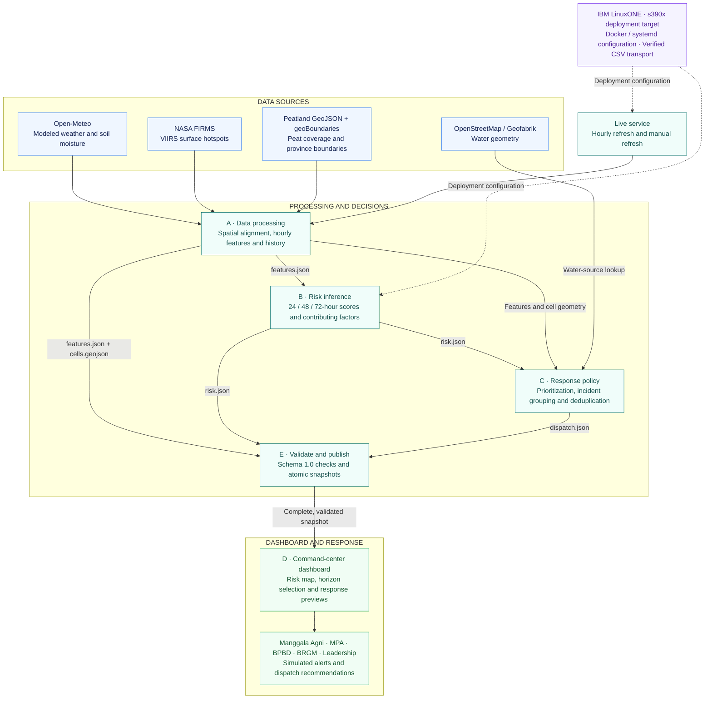

# Peat Fire Early-Warning Agent

### System architecture

Weather, satellite hotspots and peatland geography inform surface-hotspot risk estimates for **40 cells across Indonesian Kalimantan**, with **24, 48 and 72-hour** prediction horizons. A deterministic response policy turns those estimates into simulated actions for a shared command-center dashboard.

Solid arrows show application data and control flow. Dashed arrows show deployment configuration; they do not establish a verified LinuxONE deployment.

### Data sources

| Source | Contribution | Reference |
| --- | --- | --- |
| Open-Meteo | Modeled hourly weather and soil moisture | [Forecast API](https://open-meteo.com/en/docs) · [Historical Forecast API](https://open-meteo.com/en/docs/historical-forecast-api) |
| NASA FIRMS | Historical and near-real-time VIIRS hotspot detections | [Downloads](https://firms.modaps.eosdis.nasa.gov/download/) · [API](https://firms.modaps.eosdis.nasa.gov/api/) |
| geoBoundaries | Indonesian province boundaries | [Indonesia ADM1](https://www.geoboundaries.org/api/current/gbOpen/IDN/ADM1/) |
| OpenStreetMap / Geofabrik | Water geometry for response recommendations | [Kalimantan extract](https://download.geofabrik.de/asia/indonesia/kalimantan.html) · [Attribution and licence](https://www.openstreetmap.org/copyright) |
| Local peatland GeoJSON | Peat polygons for cell selection and peat coverage | `data/raw/Indonesia_Peat_Lands.geojson`; original source URL and licence remain unverified |

### LinuxONE integration

The repository provides Docker configurations and a systemd service template for deployment. A verified gzip CSV transport workflow addresses the Parquet reader failure observed on the team's s390x VM, preserving source values and integrity checks while leaving the original datasets and model artifacts intact. End-to-end live operation and performance on LinuxONE still require verification.

### Operating boundaries

Weather and soil moisture are modeled values. FIRMS observes surface thermal anomalies; the solution estimates future surface-hotspot emergence. Model quality remains provisional. Alerts and dispatches are simulated, and no real SMS or operational dispatch is sent.

See the [main README](README.md), [live operations guide](e_platform/LIVE_OPERATIONS.md), [data handoff](a_data/REGIONAL_HANDOFF.md) and [frozen contracts](contracts/CONTRACTS.md) for implementation and validation details.
