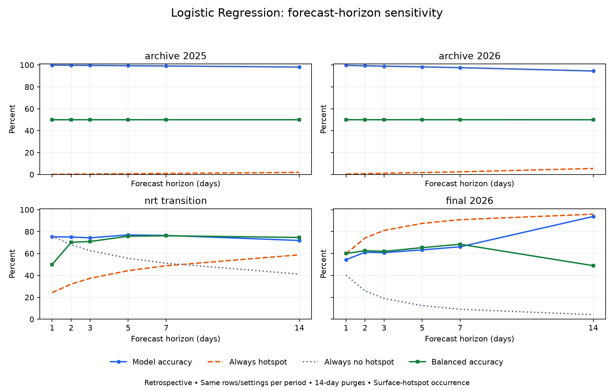
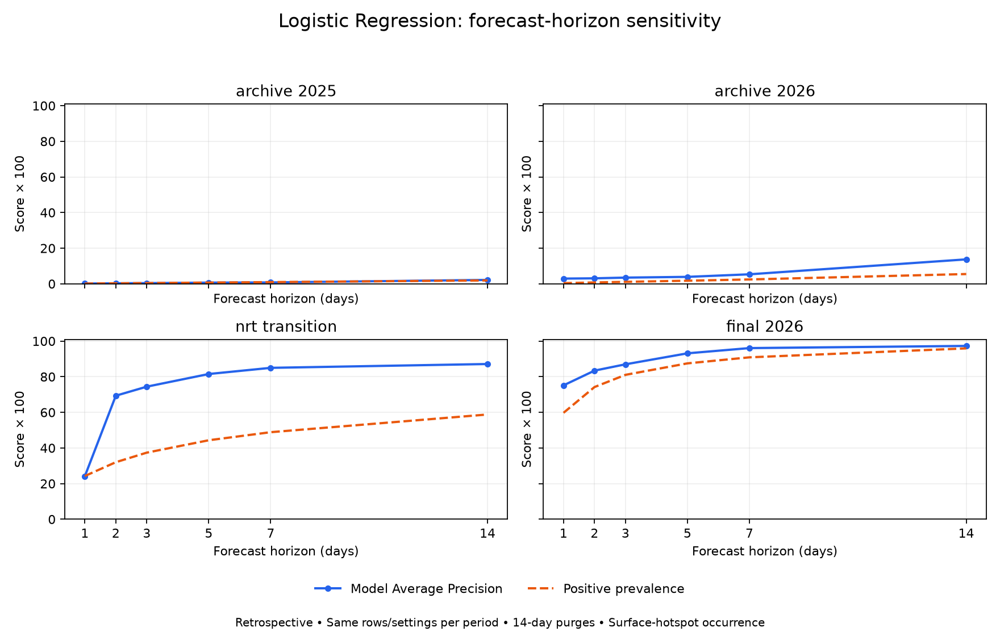

# Forecast horizon sensitivity — 2026-10-17

Longer horizons do not consistently improve prediction quality. In the latest matched period, accuracy rises to 93.8% at 14 days, but always predicting a hotspot reaches 95.9%, and model balanced accuracy is only 48.9%. In August, accuracy peaks at 5 days and falls at 14 days. In the sparse archive periods it mostly decreases with horizon. No production horizon, risk feed or saved selected model was changed.

## Controlled comparison

Tested 24, 48, 72, 120, 168 and 336 hours (1/2/3/5/7/14 days). All models use the same 27 canonical predictors, balanced Logistic Regression with C=0.001 and seed 42, training-only median imputation and scaling, and separately fitted sigmoid calibration. Cutoff stays 0.50. Hyperparameters were fixed before scoring; none were tuned against these results. These are retrospective periods already inspected in earlier work, not a fresh unseen test.

Each period uses identical train/calibration/evaluation rows for all horizons. Training ends 14 days before a 28-day calibration slice; calibration ends 14 days before evaluation. The longest horizon determines both purges, so labels from fitting cannot reach calibration and calibration labels cannot reach evaluation. Splits, class counts and the exact frozen configuration are in the evidence.

Both earlier cutoffs and common evaluation dates differ from the prior selected-model evaluation. For example, latest-period training ends July 27, calibration covers August 11–September 7 and evaluation covers September 22–October 2 (8,712 hourly cell rows). The previously reported 75.5% / 81.3% / 84.4% accuracies came from a different training/calibration cutoff and a longer evaluation period. These controlled-study numbers must not replace that scorecard or be compared with it as a model regression.

## Labels and observed futures

Experimental targets are rebuilt from Role A normalized VIIRS NOAA-20/NOAA-21 n/h-eligible in-scope events: at least one hotspot in the same cell during (t,t+h]. An event exactly at t is excluded; one exactly at t+h is included. The entire future window must lie inside the declared export coverage, otherwise its label stays null. All rebuilt 24/48/72-hour labels match Role A exactly, including nulls. Targets are verified monotonic as the window expands.

Source history SHA-256: `444152463a2aa952a6154c965d7c3876e48e4ffea1c86370ca811dafa76bfb40`. Event SHA-256: `465bcee73b373f7fca6cebdd61bc489e0e8c9af534974066f5f77653e413b5cb`. Common complete rows: 530640; incomplete rows excluded: 11088. Latest common timestamp: 2026-10-02T23:00:00Z. Declared source coverage ends at 2026-10-17T00:00:00Z (exclusive); therefore a fully observed 14-day label cannot use October 3 or later snapshots. Export completeness remains human-declared, not independently audited satellite availability. No shared datasets were edited.

Longer targets are private research labels under ignored `b_model/runs/horizon_study_20261017/`. Schema 1.0 outputs remain restricted to 24/48/72 hours. Deploying longer horizons would require team agreement and a contract revision.

## Latest matched period: September 22–October 2

| Horizon | Accuracy | Always-hotspot accuracy | Balanced accuracy | Precision / recall at 0.50 | AP / prevalence |
| --- | ---: | ---: | ---: | ---: | ---: |
| 1 days | 54.4% | 59.7% | 60.0% | 80.6% / 31.1% | 0.752 / 0.597 |
| 2 days | 61.2% | 74.2% | 62.6% | 83.3% / 59.6% | 0.834 / 0.742 |
| 3 days | 60.8% | 81.1% | 62.0% | 87.7% / 60.1% | 0.870 / 0.811 |
| 5 days | 63.3% | 87.5% | 65.3% | 93.2% / 62.6% | 0.931 / 0.875 |
| 7 days | 66.1% | 90.9% | 68.4% | 95.8% / 65.6% | 0.961 / 0.909 |
| 14 days | 93.8% | 95.9% | 48.9% | 95.8% / 97.8% | 0.973 / 0.959 |

Accuracy counts correct positive and negative classifications. Balanced accuracy averages positive recall and negative recall; a constant prediction scores 50% when both classes exist. At 14 days the high accuracy mainly follows a nearly all-positive target, not strong discrimination at cutoff 0.50. Average Precision (AP) is a ranking measure, not accuracy, and also depends on positive prevalence.

## All periods

| Period | Days | Accuracy | Always-hotspot | Always-no-hotspot | Balanced accuracy | AP |
| --- | ---: | ---: | ---: | ---: | ---: | ---: |
| archive_2025 | 1 | 99.9% | 0.1% | 99.9% | 50.0% | 0.0015 |
| archive_2025 | 2 | 99.7% | 0.3% | 99.7% | 50.0% | 0.0030 |
| archive_2025 | 3 | 99.6% | 0.4% | 99.6% | 50.0% | 0.0038 |
| archive_2025 | 5 | 99.3% | 0.7% | 99.3% | 50.0% | 0.0066 |
| archive_2025 | 7 | 99.0% | 1.0% | 99.0% | 50.0% | 0.0077 |
| archive_2025 | 14 | 98.1% | 1.9% | 98.1% | 50.0% | 0.0219 |
| archive_2026 | 1 | 99.6% | 0.4% | 99.6% | 50.0% | 0.0294 |
| archive_2026 | 2 | 99.2% | 0.8% | 99.2% | 50.0% | 0.0309 |
| archive_2026 | 3 | 98.9% | 1.1% | 98.9% | 50.0% | 0.0348 |
| archive_2026 | 5 | 98.3% | 1.7% | 98.3% | 50.0% | 0.0390 |
| archive_2026 | 7 | 97.6% | 2.4% | 97.6% | 50.0% | 0.0534 |
| archive_2026 | 14 | 94.5% | 5.5% | 94.5% | 50.0% | 0.1372 |
| nrt_transition | 1 | 75.2% | 24.3% | 75.7% | 49.9% | 0.2412 |
| nrt_transition | 2 | 75.1% | 32.0% | 68.0% | 70.2% | 0.6935 |
| nrt_transition | 3 | 74.3% | 37.4% | 62.6% | 71.0% | 0.7442 |
| nrt_transition | 5 | 77.0% | 44.3% | 55.7% | 75.8% | 0.8153 |
| nrt_transition | 7 | 76.5% | 48.9% | 51.1% | 76.2% | 0.8499 |
| nrt_transition | 14 | 71.9% | 58.8% | 41.2% | 74.6% | 0.8714 |
| final_2026 | 1 | 54.4% | 59.7% | 40.3% | 60.0% | 0.7515 |
| final_2026 | 2 | 61.2% | 74.2% | 25.8% | 62.6% | 0.8343 |
| final_2026 | 3 | 60.8% | 81.1% | 18.9% | 62.0% | 0.8697 |
| final_2026 | 5 | 63.3% | 87.5% | 12.5% | 65.3% | 0.9314 |
| final_2026 | 7 | 66.1% | 90.9% | 9.1% | 68.4% | 0.9607 |
| final_2026 | 14 | 93.8% | 95.9% | 4.1% | 48.9% | 0.9729 |

The archive periods show why accuracy alone is misleading: predicting no hotspot yields about 95–100% accuracy depending on horizon, while balanced accuracy is approximately 50%. In the August transition, 5 days reaches 77.0% accuracy and 14 days falls to 71.9%. There is no consistent monotonic increase. These are correlated cell/windows, not independent fire events or new ignitions.

Always-hotspot/no-hotspot are fixed descriptive references. The best constant is selected from evaluation prevalence only to diagnose how easy raw accuracy is; it is not a tuned deployable baseline or evidence of out-of-sample calibration. Quiet-cell metrics, reliability bins, Brier error and fixed-cutoff confusion counts are retained in `results.json`. Independent horizons can produce nonmonotonic probabilities; no postprocessing forced scores upward.

## Figures and evidence

PNG and standalone SVG versions are saved beside the figures. Plotting uses optional Matplotlib 3.11.2; see `requirements-analysis.txt`. This adds no model-serving dependency. Protocol, input fingerprints, split audits, full metrics and `summary.csv` are in [experiment_results/20261017_horizons/](experiment_results/20261017_horizons/). Model bundles and per-row predictions remain local under ignored `runs/`.

All 130 Role B tests passed. New checks cover exact future-window endpoints, eligibility, incomplete and unconfirmed coverage, full longest-horizon purges, and misleading majority-class accuracy. Existing source hashes were preserved.

Reproduce with a copy of `conf/horizon_study.yaml` pointing to fresh run/evidence directories, then `python -m b_model.horizon_study --config <copy.yaml>`. The runner refuses existing directories. Generate figures with `MPLCONFIGDIR=/tmp/peat-horizon-mpl python -m b_model.plot_horizon_study --evidence-dir <evidence>`.
