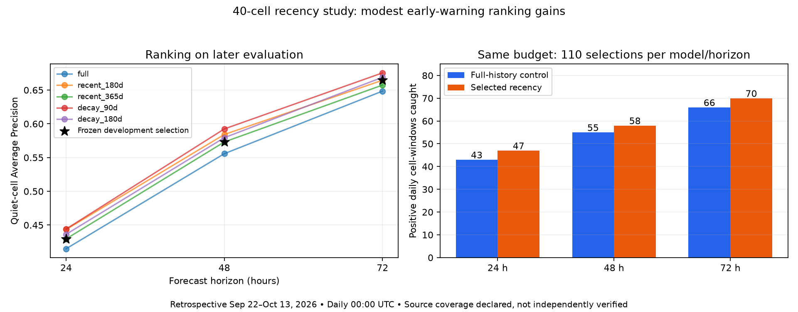

# Recency, alert operating points and source consistency — 2026-10-17

The requested five-strategy study is complete: 60 fits across four dated periods and three horizons. A 12-month training window was selected for 24/48 hours and a 6-month window for 72 hours using development data only. On the later period, these choices modestly improve quiet-cell ranking and same-budget hits. Probability errors and cutoff-based performance do not improve consistently, and calibration-chosen alert filters miss many positives. The current regional handoff remains unchanged; an isolated candidate and research operating points are available for review.

## Frozen design

- Compared full history, recent 180 days, recent 365 days, and decay half-lives of 90 and 180 days. All use the existing 27 features, LR C=0.001 / 0.001 / 0.1, seed 42 and the same dated folds. At early folds, a nominal recent-year window is capped by available history and can equal full history.
- Recent-window preprocessing uses only that training window. Decay uses age relative to the latest training timestamp. Weighted class balancing is combined with decay once, class_weight is disabled, and final loss weights have mean one and equal positive/negative total weight. Imputation and scaling use unweighted training rows; recency weights affect the training loss.
- Each calibration period is divided into probability calibration, a 72-hour internal purge, and later policy calibration. No reweighting is applied to either calibration slice or evaluation. Final probability calibration is September 4–9; policy calibration September 13–18; final evaluation September 22–October 13. Training ends August 31, with full 72-hour external gaps.
- Before final fitting/scoring, select the largest mean development quiet-cell AP, requiring at least 95% of the full-history mean overall AP. Break ties by overall Brier then name. Selection uses three earlier folds; no final-period winner is substituted afterward.
- Fit separate all-cell and quiet-only alert thresholds using policy-calibration daily 00Z rows. Rank top five per timestamp, then choose the threshold maximizing whole-pool F1, including positive windows outside the cap; ties use the highest threshold. A pool without candidate positives disables alerts. Thresholds are saved before evaluation.
- This is retrospective: the dates/final period were already inspected in prior work. It is not an untouched prospective or geographic test, and the source completeness assumption remains unverified. No random split, synthetic minority data, score forcing, shared contract change or C dispatch change was introduced.

Source history SHA-256: `83c226e5c9fd72c00bbfd487c0fa488147ac7ac90fe939ae64a25f2e0074f945`. Source rows with complete labels: 653760; incomplete rows excluded: 2880. Split, class and effective-weight audits are saved per strategy/fold.

## Development selection

| Horizon | Selected strategy | Mean quiet AP: full / selected | Mean overall AP: full / selected |
| --- | --- | ---: | ---: |
| 24 h | recent_365d | 0.1044 / 0.1057 | 0.3318 / 0.3263 |
| 48 h | recent_365d | 0.1724 / 0.1727 | 0.3637 / 0.3616 |
| 72 h | recent_180d | 0.2003 / 0.2009 | 0.3640 / 0.3616 |

The recent-180-day 24-hour option had higher mean development quiet AP but failed the predeclared overall-AP guard. Decay strategies were evaluated and did not win the frozen development rule. A 90-day decay performs well on the later evaluation, but choosing it now because of those scores would reuse the final period for selection.

## Later evaluation at exactly the same alert budget

Each quiet pool has 573 eligible daily cell/windows across 22 snapshots. Every fixed-budget comparison issues 110 selections per horizon/model. These are future-positive windows, not independent ignitions.

| Horizon | Quiet AP: full / selected | Hits: full / selected | False alerts: full / selected | Selected recall among daily positive windows |
| --- | ---: | ---: | ---: | ---: |
| 24 h | 0.4149 / 0.4295 | 43 / 47 | 67 / 63 | 47/68 (69.1%) |
| 48 h | 0.5558 / 0.5731 | 55 / 58 | 55 / 52 | 58/103 (56.3%) |
| 72 h | 0.6485 / 0.6646 | 66 / 70 | 44 / 40 | 70/125 (56.0%) |

Those gains are 4, 3 and 4 additional positive windows at equal workload. They are descriptive improvements, not established statistically significant or independent-event benefits.

| Horizon | Overall AP: full / selected | Brier: full / selected (lower better) | Accuracy at 0.50: full / selected |
| --- | ---: | ---: | ---: |
| 24 h | 0.8480 / 0.8469 | 0.1346 / 0.1365 | 78.2% / 77.9% |
| 48 h | 0.9024 / 0.9034 | 0.1191 / 0.1202 | 82.7% / 82.4% |
| 72 h | 0.9273 / 0.9324 | 0.1035 / 0.0994 | 86.4% / 87.3% |

The matched control uses the same split probability/policy calibration as the candidate. It differs from the current published regional model, which fits probabilities using the entire calibration slice. In particular, previously reported published accuracies must not be substituted for the matched control. The selected 24/48-hour candidates have slightly worse accuracy and Brier; 72 hours improves both here.

## Calibration-selected alert operating points

These are score filters after a daily top-five cap, not replacements for the fixed LOW/MODERATE/HIGH/CRITICAL boundaries. All/quiet thresholds are separately frozen; the table shows quiet-only values. Calibration-filtered policies may use fewer than five alerts, so their actual workloads differ.

| Horizon | Threshold: full / selected | Selected alerts | Selected hits | Selected false alerts | Selected precision / recall | Full policy hits / alerts |
| --- | ---: | ---: | ---: | ---: | ---: | ---: |
| 24 h | 0.354 / 0.325 | 36 | 17 | 19 | 47.2% / 25.0% | 13 / 30 |
| 48 h | 0.427 / 0.532 | 35 | 23 | 12 | 65.7% / 22.3% | 37 / 57 |
| 72 h | 0.629 / 0.324 | 101 | 69 | 32 | 68.3% / 55.2% | 34 / 45 |

Thresholds reduce workload but also miss many windows compared with spending the full budget: selected 24/48/72-hour policies catch 17/23/69 positives versus 47/58/70 with the fixed five. The 48-hour selected policy underperforms the full-history calibrated policy in recall/F1 on this period. There is no basis to silently enable these thresholds as a universal improvement.

At cutoff 0.50 on all hourly quiet windows, the selected 24-hour candidate catches only 7.2% of positives (matched control 6.8%). The current regional model previously caught 9.4% under its different probability calibration. Good budget ranking therefore does not establish well-calibrated early-warning probabilities.

## What the source audit resolves

[SOURCE_CONSISTENCY.md](SOURCE_CONSISTENCY.md) records verified raw hashes, matching confidence encoding, both satellites throughout, no duplicate normalized acquisition keys, broadly similar observed coordinate envelopes and type-field differences. These checks find no obvious parser/satellite/duplicate explanation for the jump.

The human confirmed that archive exports end June 30 and NRT begins July 1, with no overlap and no saved query parameters/bounding box/filter settings. Identical upstream spatial export coverage cannot be established, and the share of the increase caused by actual activity remains unknown. The exact controlled-re-export request is in `experiment_results/20261017_source_consistency/role_a_request.json`. No extra credentialed request or external message was sent. Existing labels are unchanged and all study results remain conditional on the declared coverage.

## Artifacts, checks and recommendation

Keep `CURRENT_HANDOFF.json` and the current regional model for the main demo. The review candidate is in `model_recency_candidate/`, with source/selection provenance and calibration-only `operating_points.json`. Run `python -m b_model.predict --config-name replay_recency` to inspect its separate 120-record replay. It passed schema/scope/latency checks in 2.52 seconds locally. Production risk boundaries, shared feeds and dispatch are unchanged. The candidate passes only the existing minimal recorded-baseline/recall gate, not operational certification.

All **144 software tests passed, with no skips**. New tests check decay age/normalization, one-time class weighting, recent-window boundaries, three full temporal purges, development-only selection and the overall-AP guard, whole-pool policy F1, cap/threshold ties and calibration-policy immutability. Vectorized budget calculations were checked against all four saved real-data budget comparisons; outputs matched. Source and current handoff/artifact hashes remain preserved.

Full evidence, all five strategies, policies and all/quiet hourly/daily diagnostics are in [experiment_results/20261017_recency/](experiment_results/20261017_recency/). The source audit has its own directory. No fresh future data was obtained, and overlapping forecast windows remain dependent.

The next valid promotion evidence is a later reserved/forward replay with verified export settings, comparing the frozen model and alert policy at the intended workload. Repeating selection against this final period would not supply that evidence.
