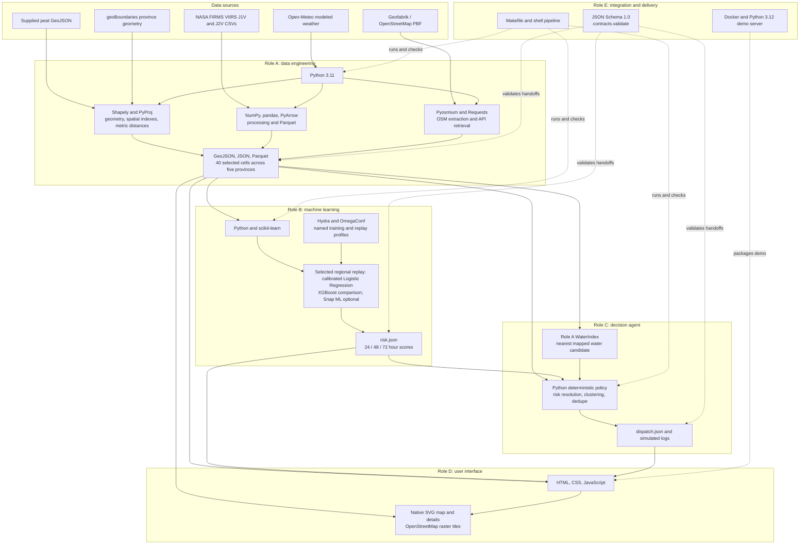
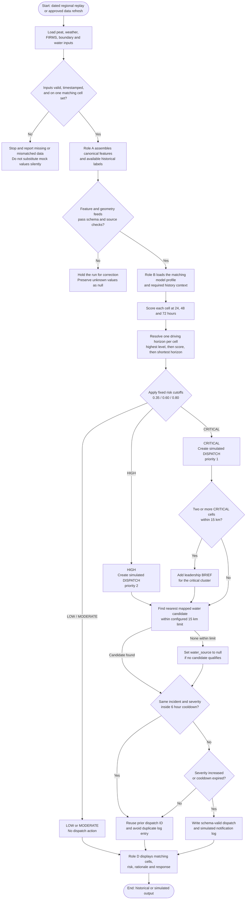

# System diagrams

These diagrams describe the current Peatland Alert System and its 40-cell regional historical replay. They distinguish source processing, model inference, policy decisions, and presentation. Schema 1.0 remains the handoff contract.

## 1. Technology stack

## 2. Architecture and data pipeline

```mermaid
flowchart LR
    subgraph raw[Raw and reference inputs]
        P[Peat polygons]
        F[VIIRS J1V / J2V detections]
        W[Open-Meteo historical weather]
        O[OSM water features]
        G[Five-province boundary]
    end

    subgraph A[Role A: prepare regional dataset]
        A1[Validate sources and preserve provenance]
        A2[Build 0.1 degree peat grid<br/>782 qualifying regional cells]
        A3[Select 40 peat-centered cells<br/>8 per province]
        A4[Join 40 weather series and FIRMS events]
        A5[Calculate 27 canonical features<br/>and 24 / 48 / 72 hour targets]
        A6[Publish matching features, history,<br/>cells and water catalogue]
    end

    subgraph B[Role B: regional replay model]
        B1[Train and compare per-horizon models<br/>with chronological embargoes]
        B2[Load matching feature and history snapshot]
        B3[Infer one risk score per cell<br/>for each horizon]
        B4[risk.json<br/>40 cells x 3 horizons = 120 rows]
    end

    subgraph C[Role C: deterministic response policy]
        C1[Join risk, features and cell geometry]
        C2[Resolve each cell to its driving horizon]
        C3[Apply fixed risk levels, clustering,<br/>cooldown and escalation]
        C4[Look up nearby mapped water<br/>within configured distance]
        C5[dispatch.json<br/>and simulated notification log]
    end

    subgraph D[Role D: command-center view]
        D1[Load one matching regional snapshot]
        D2[Map cells, risks, factors and dispatches]
        D3[Show missing feeds and historical status clearly]
    end

    E[Role E: contracts, validation,<br/>demo runner and container]

    P --> A1
    F --> A1
    W --> A1
    O --> A1
    G --> A1
    A1 --> A2 --> A3 --> A4 --> A5 --> A6
    A6 --> B1
    A6 --> B2
    B1 --> B3
    B2 --> B3 --> B4
    A6 --> C1
    B4 --> C1 --> C2 --> C3 --> C4 --> C5
    A6 --> D1
    B4 --> D1
    C5 --> D1 --> D2 --> D3
    E -. validates schemas and references .-> A6
    E -. packages and serves demo .-> D1
```

### Scope and handoff notes

- The regional sample has **40 cells**, eight in each of Central, East, North, South, and West Kalimantan. It is not a complete weather/history grid: 782 cells qualify in the wider spatial inventory, while weather and hourly training features were prepared for the selected 40.
- Keep A's geometry/features/history, B's risk feed, and C's dispatch feed on the same cell IDs and timestamp. Do not combine the 40-cell regional handoff with the legacy 33-cell Central Kalimantan feed.
- FIRMS archive files end on **2026-06-30** and NRT files begin on **2026-07-01**. They do not overlap locally, and the original export filters were not saved. The team's declared coverage does not independently establish identical upstream geographic coverage.
- Open-Meteo soil and weather values are modeled fields. FIRMS points are VIIRS surface-hotspot detections; they are not direct peat-fire or underground-fire measurements.
- Historical labels count eligible detections anywhere in a cell during the future horizon. A peat-centered cell does not make its label peat-only.
- Schema 1.0 uses UTC timestamps ending in `Z`, named `lat` / `lon` in JSON, and `[lon, lat]` in GeoJSON. Missing measurements remain null.

## 3. Design flowchart: replay to response

HIGH and CRITICAL create simulated dispatches for all five audiences. CRITICAL clusters can add a leadership brief. The optional language-model integration may rephrase approved message templates; coordinates, scores, risk levels, recipients, and numeric facts remain controlled by the deterministic policy. No real SMS or field dispatch is sent.

## Current integration status

Role A's 40-cell data handoff and Role B's matching 120-row regional risk output are prepared. Role C's deterministic policy is implemented. The diagrams describe the intended matching A-to-B-to-C-to-D path; the team still needs to wire and verify all four feeds together for the regional demo. Role E's Docker server is an offline demo server, not a production deployment.
