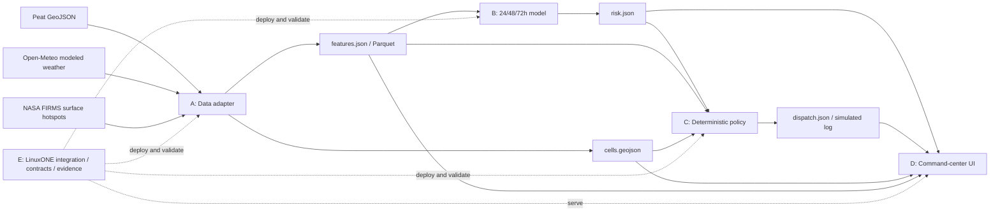

# Architecture and ownership

Current scaffold: validated synthetic mocks → isolated files → local handoff viewer. Existing B inference code is preserved. Live A/C adapters and D's final product are role deliverables. Optional LLM wording belongs after deterministic policy, with structured numbers and coordinates validated. No notification is sent to a real recipient.
